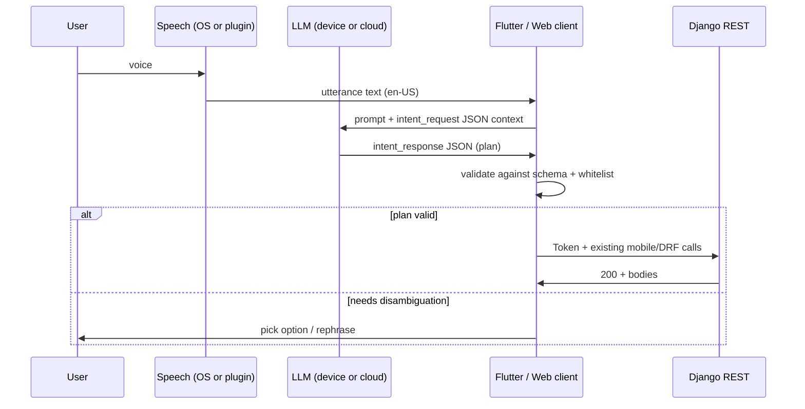

# Agent intent sketch (voice / LLM → API)

This document is a **design sketch** for English-only flows: speech or text
describes what the user wants; a model (cloud or on-device) emits **structured
JSON**; the mobile or web client validates it and calls **existing** REST
endpoints. No LLM runs inside Django in this sketch.

## Design rules

1. **Models propose, code disposes** — the server never executes raw model text.
   Only validated JSON shapes and whitelisted `action` values are accepted when
   you add a future `POST /api/mobile/agent/intent/` (optional).
2. **Reuse current APIs** — mobile sync and DRF viewsets already enforce
   ownership and validation. An agent layer should map intents to these calls
   rather than inventing parallel writes.
3. **Confirm destructive work** — deletes and large transfers should set
   `requires_user_confirm` in a plan step (client shows UI before calling APIs).

## Request / response JSON Schema

| File | Role |
|------|------|
| [schema/intent_request.schema.json](schema/intent_request.schema.json) | Payload the client may send to a future intent endpoint, or embed as the user message wrapper for an LLM. |
| [schema/intent_response.schema.json](schema/intent_response.schema.json) | Normalized plan the client executes locally against tokens + REST. |

## End-to-end flow



## Auth (today)

| Client | Obtain token | Use token |
|--------|----------------|-----------|
| Mobile (email) | `POST /api/mobile/auth/token/` JSON `email`, `password` | `Authorization: Token <key>` |
| Generic | `POST /api-token-auth/` (username field holds **email** per project docs) | Same header |

## Action catalog → existing HTTP (v1 sketch)

Base path for mobile sync: `/api/mobile/…`. Router: `/api/budgets/`, `/api/goals/`,
`/api/goal-contributions/`.

| `action` (stable id) | HTTP | Notes |
|----------------------|------|--------|
| `budget.list` | `GET /api/mobile/budgets/pull/` | Optional `?updated_after=` ISO-8601 |
| `budget.upsert` | `POST /api/mobile/budgets/push/` | Body `{ "budgets": [ { month, income, currency, id?, is_archived? } ] }` — see `MobileBudgetPushItemSerializer` |
| `category.list` | `GET /api/mobile/categories/pull/` | Same `updated_after` pattern |
| `category.upsert` | `POST /api/mobile/categories/push/` | Body `{ "categories": [ … ] }` |
| `tag.list` | `GET /api/mobile/tags/pull/` | |
| `tag.upsert` | `POST /api/mobile/tags/push/` | Body `{ "tags": [ … ] }` |
| `expense.list` | `GET /api/mobile/expenses/pull/` | |
| `expense.upsert` | `POST /api/mobile/expenses/push/` | Body `{ "expenses": [ … ] }` — requires `budget_id`, `name`, `amount` |
| `sub_expense.list` | `GET /api/mobile/sub-expenses/pull/` | |
| `sub_expense.upsert` | `POST /api/mobile/sub-expenses/push/` | Body `{ "sub_expenses": [ … ] }` |
| `goal.list` | `GET /api/goals/` | DRF list |
| `goal.create` | `POST /api/goals/` | Body per `GoalSerializer` |
| `goal.retrieve` | `GET /api/goals/{id}/` | |
| `goal.update` | `PUT` / `PATCH /api/goals/{id}/` | |
| `goal.delete` | `DELETE /api/goals/{id}/` | Set `requires_user_confirm` in plans |
| `goal_contribution.create` | `POST /api/goal-contributions/` | |
| `budget.drf_list` | `GET /api/budgets/` | Alternative to mobile pull |

Implementers: keep this table as the **single whitelist** an LLM is allowed to
emit; reject unknown `action` strings in the client (and again in a future server
validator).

## Example `intent_response` (resolved)

```json
{
  "schema_version": "1.0",
  "status": "resolved",
  "locale": "en-US",
  "confidence": 0.82,
  "plan": [
    {
      "step_id": "s1",
      "action": "expense.upsert",
      "requires_user_confirm": false,
      "args": {
        "expenses": [
          {
            "budget_id": 12,
            "name": "Groceries",
            "amount": "120.50",
            "is_recurring": false,
            "category_id": 3
          }
        ]
      }
    }
  ]
}
```

The Flutter app would `POST /api/mobile/expenses/push/` with the inner
`expenses` list after confirming `budget_id` belongs to the synced user data.

## Optional next implementation steps

1. Add `POST /api/mobile/agent/intent/` that accepts `intent_request`, runs **no**
   model server-side, and returns `422` with hints — or later calls a hosted model
   and still validates output against `intent_response` schema.
2. Check in a **golden-file** test: sample utterances → expected JSON plans
   (regression for prompt tuning).
3. Pin JSON Schema in CI (`jsonschema` CLI or Python) for fixtures under
   `docs/agent_intent/examples/`.

## Related code

- URL registration: `budgetapp/api_urls.py`
- Mobile push serializers: `budgetapp/serializers_mobile.py`
- Mobile sync views: `budgetapp/api_mobile_sync.py`, `budgetapp/api_mobile_catalog.py`
