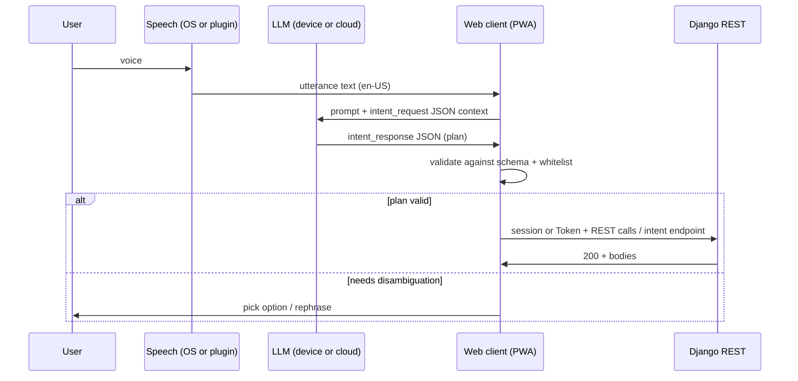

# Agent intent sketch (voice / LLM → API)

This document is a **design sketch** for English-only flows: speech or text
describes what the user wants; a model (cloud or on-device) emits **structured
JSON**; the web client or a small server endpoint validates it and calls **existing**
REST endpoints or service functions. No LLM runs inside Django in this sketch.

## Design rules

1. **Models propose, code disposes** — the server never executes raw model text.
   Only validated JSON shapes and whitelisted `action` values are accepted when
   you add a future `POST /api/agent/intent/` (optional).
2. **Reuse current code** — the DRF viewsets, the forms in `budgetapp/app/forms.py`
   and the functions in `budgetapp/services/` already enforce ownership and validation. An agent layer should map intents to these calls
   rather than inventing parallel writes.
3. **Confirm destructive work** — deletes and large transfers should set
   `requires_user_confirm` in a plan step (client shows UI before calling APIs).

## Request / response JSON Schema

| File | Role |
|------|------|
| [schema/intent_request.schema.json](schema/intent_request.schema.json) | Payload the client may send to a future intent endpoint, or embed as the user message wrapper for an LLM. |
| [schema/intent_response.schema.json](schema/intent_response.schema.json) | Normalized plan the client executes locally against tokens + REST. |

## End-to-end flow



## Auth (today)

| Client | Obtain token | Use token |
|--------|----------------|-----------|
| Web (PWA) | The logged-in session cookie, with the CSRF token | — |
| Generic | `POST /api-token-auth/` (username field holds **email** per project docs) | `Authorization: Token <key>` |

## Action catalog → existing code (v1 sketch)

The Flutter app and its `/api/mobile/…` sync API were removed on 2026-10-15. The JSON API
is now the DRF router: `/api/budgets/`, `/api/goals/`, `/api/goal-contributions/`.
The other actions have no JSON endpoint yet. A future `POST /api/agent/intent/` runs them
with the server code in the right column, the same code the web UI uses.

| `action` (stable id) | HTTP or server code | Notes |
|----------------------|------|--------|
| `budget.list` | `GET /api/budgets/` | Each budget has its `expenses` with `sub_expenses` |
| `budget.upsert` | `POST /api/budgets/`, `PATCH /api/budgets/{id}/` | 1 budget per month: a taken month answers 400 |
| `category.upsert` | `CategoryForm` in `budgetapp/app/forms.py` | Unique name per user |
| `tag.upsert` | `AccountForm` in `budgetapp/app/forms.py` | A tag is an "account" |
| `expense.upsert` | `LineForm` in `budgetapp/app/forms.py` | Requires `budget_id`, `name`, `amount` |
| `spend.add` | `parse_spend_text` + `match_lines` + `record_spend` in `budgetapp/services/quick_add.py` | The same text grammar as quick add: `groceries 2500 #cash` |
| `spend.return` | `record_return` in `budgetapp/services/quick_add.py` | A refund on a line |
| `goal.list` | `GET /api/goals/` | DRF list |
| `goal.create` | `POST /api/goals/` | Body per `GoalSerializer` |
| `goal.retrieve` | `GET /api/goals/{id}/` | |
| `goal.update` | `PUT` / `PATCH /api/goals/{id}/` | |
| `goal.delete` | `DELETE /api/goals/{id}/` | Set `requires_user_confirm` in plans |
| `goal_contribution.create` | `POST /api/goal-contributions/` | |

Implementers: keep this table as the **single whitelist** an LLM is allowed to
emit; reject unknown `action` strings in the client (and again in a future server
validator).

## Example `intent_response` (resolved)

```json
{
  "schema_version": "1.0",
  "status": "resolved",
  "locale": "en-US",
  "confidence": 0.82,
  "plan": [
    {
      "step_id": "s1",
      "action": "expense.upsert",
      "requires_user_confirm": false,
      "args": {
        "expenses": [
          {
            "budget_id": 12,
            "name": "Groceries",
            "amount": "120.50",
            "is_recurring": false,
            "category_id": 3
          }
        ]
      }
    }
  ]
}
```

The intent endpoint would check that `budget_id` belongs to the user, then save each item
of the inner `expenses` list with `LineForm`.

## The MCP server (built)

`manage.py mcp_server` runs an [MCP](https://modelcontextprotocol.io/) server over
stdio for a local client such as LM Studio. See `docs/mcp_server.md` for how to run
it and its tool list. It is a second, simpler implementation of this same design
rule: each tool is a function in `budgetapp/services/mcp_tools.py` that calls the
same form or service a REST action or the web UI would use, for 1 whitelisted
action, for 1 user. It does not replace `POST /api/agent/intent/` below; that
endpoint would still suit a model embedded in the web client itself.

A budget can also be exported as portable JSON (`budget_export_json` tool, or
`GET /api/budgets/{id}/export/`), for backup or for a companion app such as
[budget-notes](https://github.com/Thireb/budget-notes). See `docs/mcp_server.md`.

## Optional next implementation steps

1. Add `POST /api/agent/intent/` that accepts `intent_request`, runs **no**
   model server-side, and returns `422` with hints — or later calls a hosted model
   and still validates output against `intent_response` schema.
2. Check in a **golden-file** test: sample utterances → expected JSON plans
   (regression for prompt tuning).
3. Pin JSON Schema in CI (`jsonschema` CLI or Python) for fixtures under
   `docs/agent_intent/examples/`.

## Related code

- URL registration: `budgetapp/api_urls.py`
- REST views and serializers: `budgetapp/api.py`, `budgetapp/api_goals.py`, `budgetapp/serializers.py`
- Quick add grammar and spends: `budgetapp/services/quick_add.py`
- MCP server: `budgetapp/management/commands/mcp_server.py`, `budgetapp/services/mcp_tools.py` (`docs/mcp_server.md`)
- Budget JSON export: `budgetapp/services/export.py`
